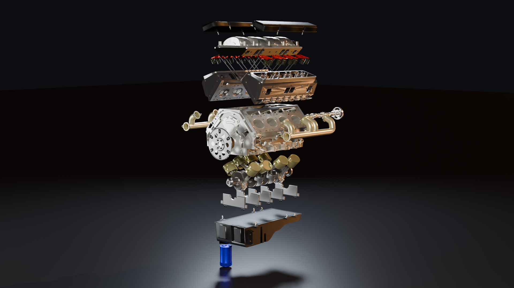
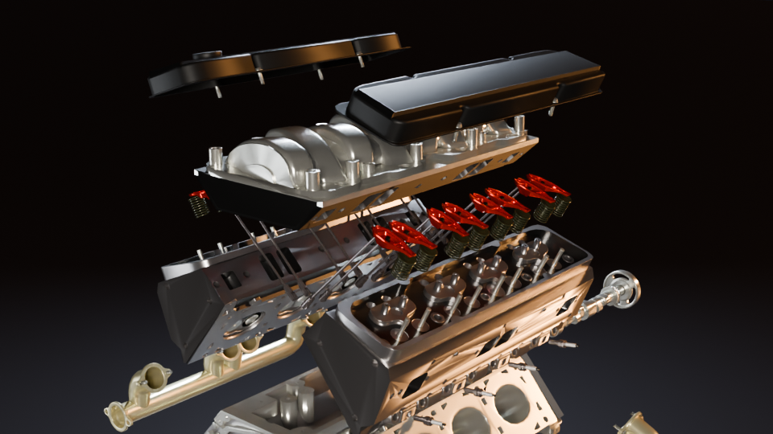
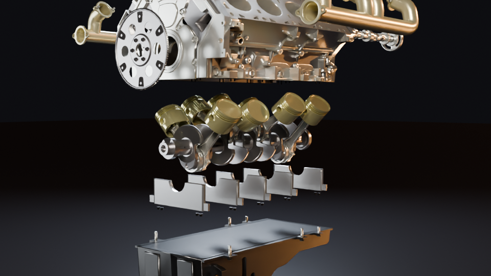
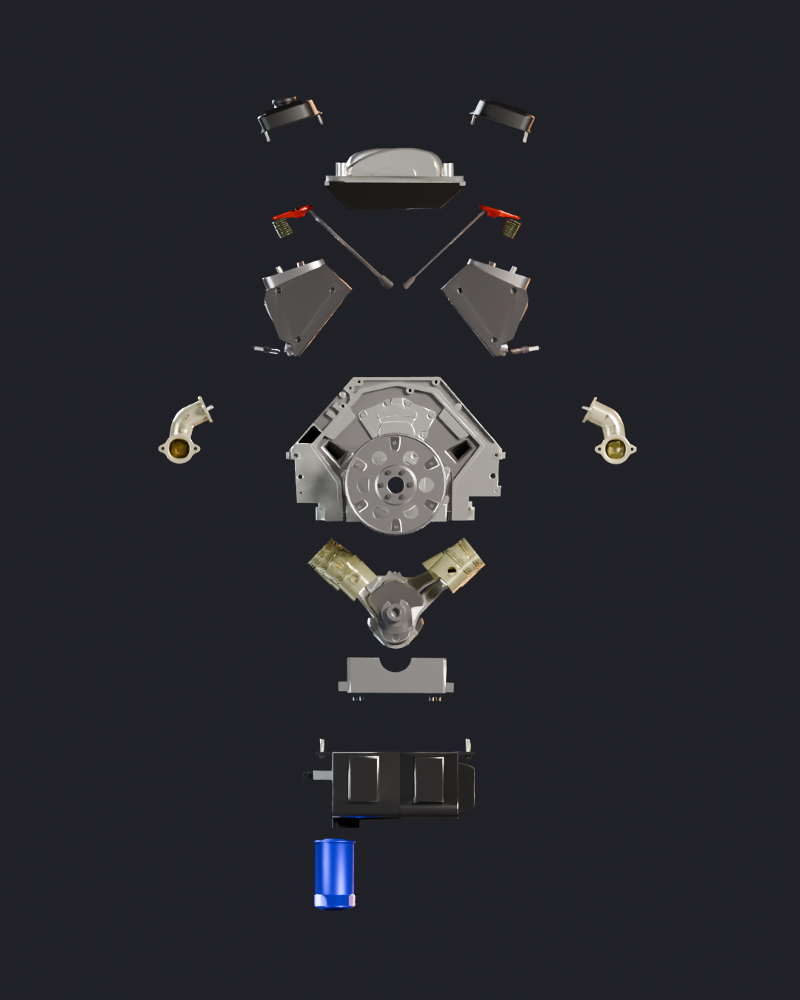
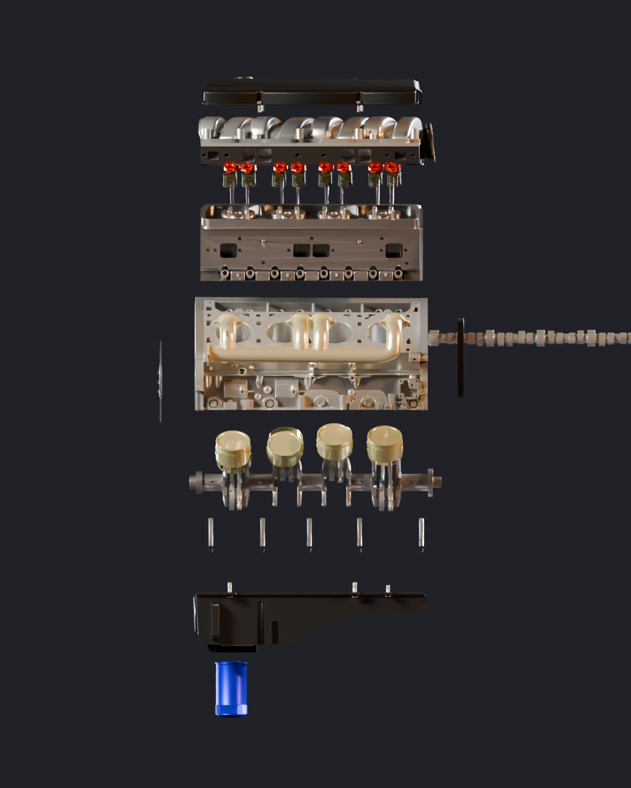
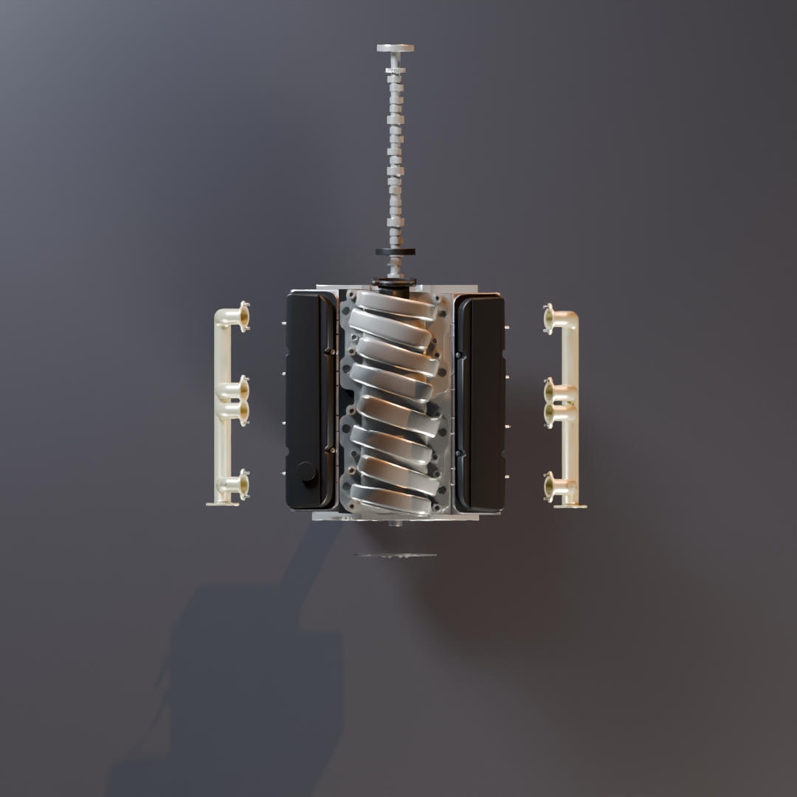
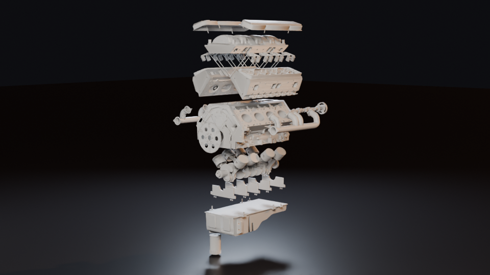

# F21GA Part 1: Blender Offline Render (V8 Engine)

**Name:** _Your Full Name_  
**Programme:** _your programme_  
**Software:** Blender 5.2 LTS, Cycles (CPU)

---

## 1. The idea
_In your own words: why an engine, why an exploded view, and what you wanted the render to show._

## 2. The model
| | |
|---|---|
| Subject | V8 engine in an exploded view: valve covers, cylinder heads with valvetrain, intake/exhaust manifolds, block, pistons and connecting rods on the crankshaft, main-bearing caps, oil pan, oil filter |
| Objects | 74 mesh objects |
| Polygons | about 1.21 million |
| Modifiers | `Auto Smooth` geometry-nodes modifier on the parts (smooth shading by angle) |
| Model source | _Fill in honestly: did you model it yourself, or where does it come from (site, author, licence)? The object names in the file are in Lithuanian (for example `VARIKLIS` = engine, `Velenas` = crankshaft, `voztuvas` = valve), and the file was first saved in Blender 3.3._ |

## 3. Materials
25 materials, each a **Principled BSDF** (most with a **Normal Map** node):
- polished and brushed metals for the block, heads and fasteners (metallic about 0.8, roughness about 0.2–0.4)
- gold-toned parts for the pistons and manifolds
- red accents on the valvetrain
- a blue oil filter

_Add a shader-editor screenshot from `Sketches_and_Drafts/` and say which material you are most pleased with._

## 4. Lighting, camera and world
The original file's camera points away from the engine, and its world HDRI (`hdri_house_garage.exr`) is not packed into the file. To render it, a `Render_Setup` collection was added:

| Item | Setting | Job |
|---|---|---|
| `Key_Area` | area light, 16,000 W, warm white | main light from front-right |
| `Rim_Area` | area light, 12,000 W, cool blue | separates the parts from the dark background |
| `Fill_Area` | area light, 4,500 W | lifts the shadow side |
| `Floor` | dark glossy plane | grounds the engine and catches reflections |
| World | near-black colour | replaces the missing HDRI |
| `CAM_Final` | 56 mm, depth of field f/5.6 | three-quarter hero view |
| `CAM_Close_*`, `CAM_Front/Side/Top` | 50 mm / orthographic | close-ups and technical views |

Colour management: AgX, Medium High Contrast.

## 5. Render settings
| Setting | Value |
|---|---|
| Engine | Cycles, CPU |
| Resolution | 1920 × 1080 |
| Samples | 48, OpenImageDenoise |
| Output | PNG |

## 6. Versions
| Folder | Contents |
|---|---|
| `Blender_Project_Files_V1` | _your earliest save_ |
| `Blender_Project_Files_V2` | _your next save_ |
| `Blender_Project_Files_V3` | _your next save_ |
| `Blender_Project_Files_V4` | `Engine_V4_Final.blend`: the finished engine plus the `Render_Setup` collection |

## 7. Extra renders
| Close-up: valvetrain | Close-up: crankshaft |
|---|---|
|  |  |

| Front | Side | Top |
|---|---|---|
|  |  |  |

Clay render (materials off, to check the forms): 

`Extra_Renders/Engine_Animation_Preview.mp4`: the earlier engine animation, compressed to 1080p.

## 8. Reflection
_Write this yourself. Prompts: what worked, what was difficult, what you learned about lighting metal, what you would change next time._

## 9. Use of AI tools
_Edit this to match your course's AI policy and what you actually did._ Claude (Anthropic) was used to add the render camera, lights and floor (`Scripts/add_render_setup.py`), to render the final and extra images (`Scripts/render_shot.py`) and to draft the structure of this Readme.
